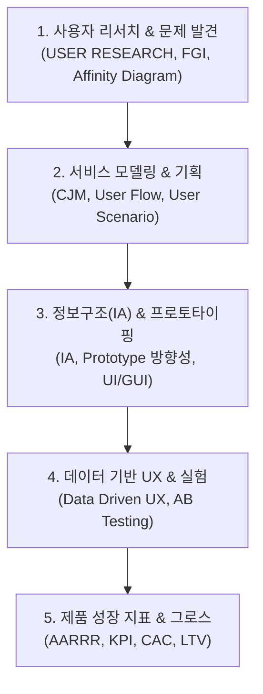

# 🎨 UX & UI 디자인 마스터 MOC (Master Map of Content)

> **Welcome to UX & UI Design Knowledge Base**  
> 사용자 중심 설계(UCD), 정성·정량 사용자 리서치, 서비스 정보구조(IA), 프로덕트 성장 지표(AARRR) 및 인터랙션 디자인을 체계화한 **197개** 지식 노트의 통합 인덱스입니다.

---

## 🗺️ UX/UI 디자인 및 제품 기획 로드맵

---

## 📑 핵심 분류 체계 및 주요 토픽

### 1. 사용자 리서치 & 인사이트 발굴 (User Research)
* **리서치 방법론**: [[04_Design/USER RESEARCH|USER RESEARCH]], [[04_Design/user research basic|User Research Basic]], [[04_Design/FGI|FGI (표적집단면접)]]
* **데이터 구조화**: [[04_Design/Affinity Diagram|Affinity Diagram (친화도 다이어그램)]], [[04_Design/Insight, Key Finding, CJM, Touch Point|인사이트 & 고객여정지도(CJM)]]

### 2. 서비스 기획 & 고객 여정 모델링
* **사용자 흐름 및 시나리오**: [[04_Design/User Flow|User Flow]], [[04_Design/User Scenario|User Scenario]]
* **요구사항 정의**: [[04_Design/Requirement Specification|Requirement Specification]], [[04_Design/MVP|MVP (최소 기능 제품)]]

### 3. 정보구조(IA) & 인터페이스 디자인
* **정보 설계**: [[04_Design/IA|IA (Information Architecture)]], [[04_Design/Do it 웹 기획|웹 기획 방법론]]
* **UI/GUI 설계**: [[04_Design/UI|UI 디자인]], [[04_Design/GUI|GUI]], [[04_Design/Prototype 방향성|프로토타입 방향성]]

### 4. 데이터 기반 UX & 제품 검증 (Data-Driven UX)
* **정량 분석 및 가설 검증**: [[04_Design/Data Driven UX|Data Driven UX]], [[04_Design/AB Testing|A/B Testing]]
* **성능 및 사용성 지표**: [[04_Design/FCP|FCP]], [[04_Design/TTFB|TTFB]], [[04_Design/ARIA|웹 접근성(ARIA)]]

### 5. 프로덕트 성장 지표 & 비즈니스 프레임워크 (Product Growth)
* **그로스 프레임워크**: [[04_Design/AARRR|AARRR (퍼널 프레임워크)]], [[04_Design/KPI|KPI 수립]]
* **수익 및 획득 지표**: [[04_Design/CAC|CAC (고객 획득 비용)]], [[04_Design/ARPU|ARPU]], [[04_Design/STP 전략|STP 전략]]

---

## 🧭 빠른 이동 및 관련 도메인
- [[index|🏠 Supreme Note 디지털 가든 홈]]
- [[01_IT Tech/00_02_IT_Tech_MOC|🌐 IT & 테크 10대 도메인 마스터 MOC]]
- [[03_Management/00_03_Management_MOC|📋 경영 & 프로젝트 관리 MOC (PMBOK 7판)]]
