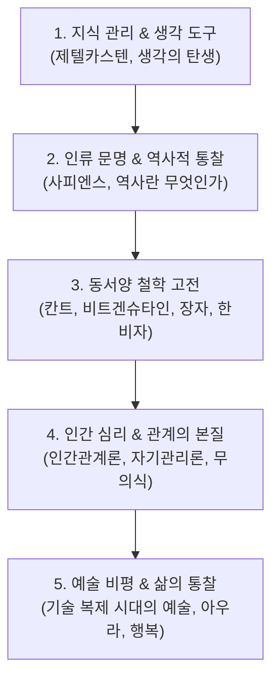

# 📖 인문학 & 철학 마스터 MOC (Master Map of Content)

> **Welcome to Humanities & Philosophy Knowledge Base**  
> 생각의 씨앗을 심고 상호 연결하는 **제텔카스텐(Zettelkasten)** 지식 관리 철학과 인류 문명사, 동서양 철학 고전, 인간 심리 및 자기성찰을 집대성한 **61개** 인문 지식 노트의 통합 인덱스입니다.

---

## 🗺️ 지식 탐구 및 사유 체계

---

## 📑 핵심 분류 체계 및 주요 토픽

### 1. 지식 관리 & 생각의 도구 (Knowledge Thinking)
* **디지털 가든 & 제텔카스텐**: [[05_Humanities/제텔카스텐|제텔카스텐 지식 관리 원칙]], [[05_Humanities/생각의 탄생|생각의 탄생]]
* **학습과 몰입**: [[05_Humanities/마지막 몰입|마지막 몰입]], [[05_Humanities/블로그 글쓰기|블로그 글쓰기]]

### 2. 인류 문명 & 역사적 통찰 (Civilization & History)
* **빅 히스토리 & 문명사**: [[05_Humanities/사피엔스|사피엔스]], [[05_Humanities/길가메시|길가메시]]
* **역사관 & 사회**: [[05_Humanities/역사란 무엇인가 1|역사란 무엇인가]], [[05_Humanities/인간 불평등 기원론|인간 불평등 기원론]], [[05_Humanities/동물농장|동물농장]]

### 3. 동서양 철학의 지혜 (Philosophy)
* **서양 근현대 철학**: [[05_Humanities/철학|철학의 개요]], [[05_Humanities/철학대철학|철학대철학]], [[05_Humanities/칸트|칸트]], [[05_Humanities/비트겐슈타인|비트겐슈타인]], [[05_Humanities/샤르트르|샤르트르]]
* **동양 철학 & 고전**: [[05_Humanities/장자|장자]], [[05_Humanities/한비자|한비자]], [[05_Humanities/세네카|세네카]]

### 4. 인간 심리 & 삶의 경영 (Psychology & Self-Management)
* **처세와 인간 이해**: [[05_Humanities/인간관계론|인간관계론]], [[05_Humanities/자기관리론|자기관리론]]
* **심리적 통찰**: [[05_Humanities/감정|감정]], [[05_Humanities/무의식|무의식]], [[05_Humanities/화, 이해하면 사라진다|화 다스리기]], [[05_Humanities/행복|행복]]

### 5. 예술, 미학 & 비평 (Art & Aesthetics)
* **미학적 담론**: [[05_Humanities/예술|예술의 본질]], [[05_Humanities/기술 복제 시대의 예술작품|기술 복제 시대의 예술작품]], [[05_Humanities/아우라|아우라 (Aura)]]

---

## 🧭 빠른 이동 및 관련 도메인
- [[index|🏠 Supreme Note 디지털 가든 홈]]
- [[01_IT Tech/00_02_IT_Tech_MOC|🌐 IT & 테크 10대 도메인 마스터 MOC]]
- [[02_Economics/00_02_Economics_MOC|📈 경제 & 금융 마스터 MOC]]
